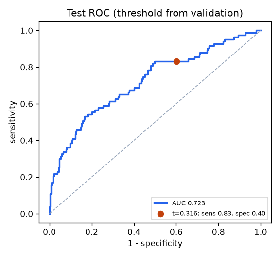
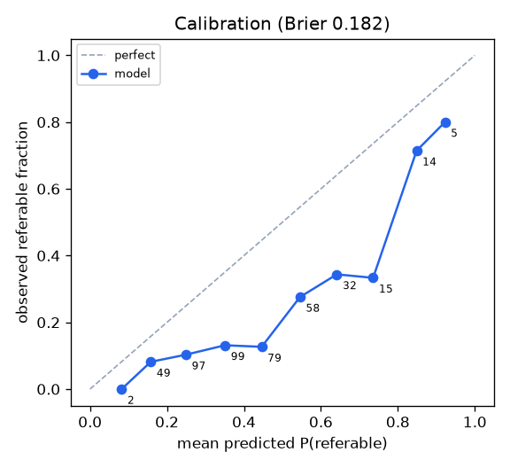
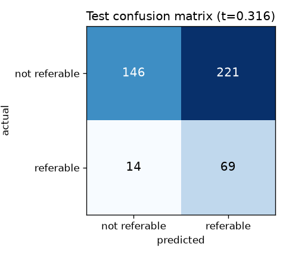

# Model card: `dr-referable`

> ⚠️ **Not a medical device.** This is a portfolio/research model. It must not be used for
> diagnosis, screening or any clinical decision.

## Model details

| | |
|---|---|
| Registered model | `dr-referable` (MLflow registry), version 1, alias `@champion` |
| Source run | `48f242e325ed44638fd4f48a8ff2c9f0` (experiment `dr-training`, run name `effb0-local-phase5`) |
| Code | commit `c698e53` (WIP Phase 5). The run was tagged `git_dirty=true`: the working tree had uncommitted changes when it ran |
| Architecture | EfficientNet-B0 (ImageNet weights), global pooling → dense `embedding` layer → sigmoid |
| Training | `local_cpu` profile: 224 px, 2 head epochs, then 3 epochs fine-tuning the top 20 backbone layers with BatchNorm frozen; class weights; early stopping on validation AUC. 6.0 min on a laptop CPU |
| Package | One MLflow pyfunc holding the Keras network, the shared preprocessing (`src/dr/preprocess.py`), the decision threshold, class names and the 32-dimension PCA used for drift features |
| Input | DataFrame with an `image_path` or `image_b64` column |
| Output per row | `p_referable`, `prediction`, `threshold`, `quality`, image statistics, `emb_0..emb_31`, `error`. A bad input gives `quality = poor:unreadable` and an error message, and the rest of the batch is still scored |

## Intended use

- **Task:** given one colour fundus photograph of one eye, estimate P(referable diabetic
  retinopathy), where referable means ICDR grade ≥ 2.
- **Intended users:** ML engineers studying MLOps practice: tracking, registry, serving and drift
  monitoring.
- **Out of scope:** any use on real patients, any clinical workflow, and images that are not
  colour fundus photographs.

## Data

EyePACS, Kaggle "Diabetic Retinopathy Detection" (2015), from the resized copy
`tanlikesmath/diabetic-retinopathy-resized`. See the [dataset card](data/README.md).

- This version was trained on the `local_cpu` subset: 2,998 images from 1,499 patients, drawn
  as a stratified sample of whole patients.
- The split is by patient, and byte-identical files are kept together: 2,100 train / 448 val /
  450 test images. No patient or MD5 appears in more than one split.
- Referable prevalence: 19.6% train, 19.6% val, 18.4% test.
- Labels are the competition grades from a single grader per image. They are known to contain
  noise.

## Decision threshold

The threshold is the highest value that gives ≥ 90% sensitivity on **validation** data:
**t = 0.316**. On validation this gives a sensitivity of 0.909 and a specificity of 0.403. The
test set was scored once, after the threshold was fixed.

## Test metrics (n = 450, 83 referable)

95% CIs come from 1,000 bootstrap resamples **by patient**, so both eyes of a patient are
resampled together. Seed 42.

| Metric | Value | 95% CI |
|---|---|---|
| ROC-AUC | 0.723 | 0.646 – 0.787 |
| PR-AUC | 0.462 | 0.332 – 0.582 |
| Sensitivity | 0.831 | 0.741 – 0.910 |
| Specificity | 0.398 | 0.340 – 0.457 |
| PPV | 0.238 | 0.175 – 0.301 |
| NPV | 0.912 | 0.861 – 0.957 |
| Accuracy | 0.478 | 0.424 – 0.529 |
| Brier score | 0.182 | 0.167 – 0.199 |

Confusion counts: TP 69, FP 221, TN 146, FN 14.

| ROC | Calibration | Confusion |
|---|---|---|
|  |  |  |

**Reading these numbers:** this version checks that the pipeline works end to end. It is not a
competitive model. It saw 2,100 images at 224 px for 5 epochs. Test sensitivity (0.83) is below
the 0.90 target, which shows how much the threshold moves when it is chosen on only 88 referable
validation images. Because of the class weights, the model's probabilities are too high (see the
calibration plot), so `p_referable` should not be read as a calibrated risk. The full-data
`colab` run (384 px, about 24k training images) is the version expected to give meaningful
numbers.

## Subgroups (test set)

From `reports/run_48f242e3/subgroup_metrics.csv`. Several groups are small, so these numbers
are indicative only. No CIs are given for subgroups.

| Subgroup | n | Prevalence | ROC-AUC | Sensitivity | Specificity |
|---|---|---|---|---|---|
| Eye: left | 225 | 17.8% | 0.696 | 0.825 | 0.341 |
| Eye: right | 225 | 19.1% | 0.748 | 0.837 | 0.456 |
| Camera aspect 3:2 | 376 | 19.4% | 0.725 | 0.822 | 0.406 |
| Camera aspect 4:3 | 74 | 13.5% | 0.728 | 0.900 | 0.359 |
| Quality: ok | 439 | 18.7% | 0.725 | 0.829 | 0.401 |
| Quality: poor | 11 | 9.1% | n/a (1 positive) | n/a | 0.300 |

- **Camera / resolution:** EyePACS mixes many camera types. Aspect ratio is used here as a stand-in
  for the camera. Across the full dataset, the 4:3 group has lower prevalence (14.6% vs 21.0%).
  Performance should be checked per group whenever the camera mix changes. The drift monitor
  (Phase 7) watches image statistics for this reason.
- **Left / right eye:** the gap seen here (AUC 0.70 vs 0.75) lies within the noise for
  n = 225 per group.
- **Image quality:** poor-quality images (blur, dark, overexposed) are flagged rather than
  rejected. Predictions on them are unreliable.

## Limitations

- Trained on a small subset at low resolution. Microaneurysms and small haemorrhages are hard to
  see at 224 px.
- The probabilities are not calibrated (class weighting). Recalibrate before reading them as risk.
- It has only been evaluated on EyePACS. It has not been tested on other populations, cameras or
  screening programmes, so performance there is unknown.
- It uses one image per eye and ignores the other eye and the patient's history.
- The labels contain noise, and test metrics are bounded by grader agreement.

## Ethical considerations

- A missed referable case (false negative) can lead to preventable vision loss. This is why the
  operating point targets sensitivity, at the cost of many false positives.
- The dataset holds little demographic information, so fairness across ethnicity, age or sex
  cannot be assessed here.
- The images are licensed by Kaggle/EyePACS and are never committed to this repository. Only
  aggregate charts and metrics are committed.
