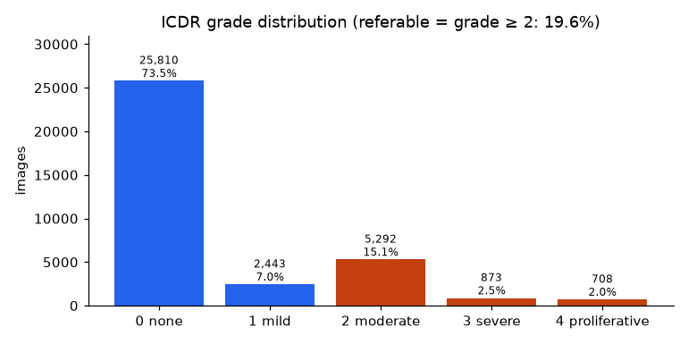
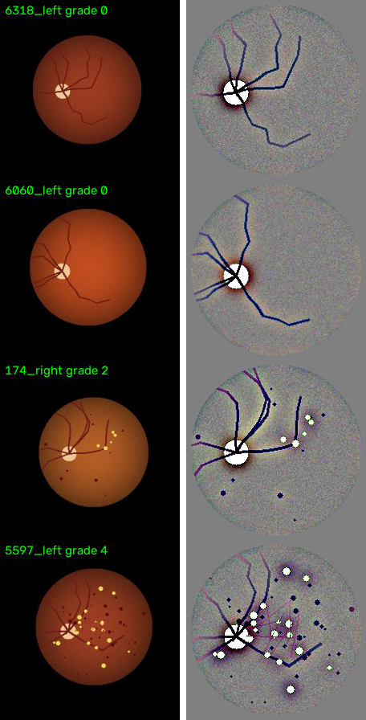

# Referable Diabetic Retinopathy: MLOps pipeline

[](https://github.com/Sammers45/diabetic-retinopathy-mlops/actions/workflows/tests.yml)

This project classifies retinal fundus photographs from EyePACS (Kaggle "Diabetic Retinopathy
Detection", 2015) as **referable diabetic retinopathy** (ICDR grade ≥ 2) or not. It is built as
a reproducible MLOps pipeline: experiment tracking, a model registry, serving and post-deployment
drift monitoring, all with MLflow.

> ⚠️ **Not a medical device.** This is a portfolio/research project. Its outputs must not be used
> for diagnosis, screening or any clinical decision.

## Status

| Phase | Scope | Status |
|---|---|---|
| 0 | Setup: config system, MLflow helper, synthetic fixtures, CI | ✅ done (`phase-0`) |
| 1 | Data download with kagglehub | ✅ done (`phase-1`) |
| 2 | Ingest, validate, image quality, EDA | ✅ done (`phase-2`) |
| 3 | Patient-level split and preprocessing (PNG cache) | ✅ done (`phase-3`) |
| 4 | Training with MLflow tracking | ✅ done (`phase-4`) |
| 5 | Evaluation, reference profile, registry, model card | ⏳ next |
| 6 | Serving (FastAPI) and prediction log | ⬜ |
| 7 | Drift monitoring (Evidently → MLflow) | ⬜ |
| 8 | Champion/challenger retraining and scheduled CI | ⬜ |

## Results

**Pending first real run.** Only metrics from a real-data run with an MLflow run ID will be
reported here. Tests use synthetic images, and their numbers are never reported as results.

## Task definition

- **Input:** one colour fundus photograph (one eye).
- **Label:** `1` if ICDR grade ≥ 2 (moderate NPDR, severe NPDR, proliferative DR), else `0`.
- **Output:** `P(referable)` and a yes/no decision. The threshold is chosen on validation data
  to give ≥ 90% sensitivity.

## Quick start (local CPU)

Python 3.11 is required, because TensorFlow does not support newer versions.

```bash
# Linux / macOS
make setup && source .venv/bin/activate
make fixtures test
```

```powershell
# Windows (no make needed; uses uv if it is installed)
.\scripts\tasks.ps1 setup
.\scripts\tasks.ps1 fixtures
.\scripts\tasks.ps1 test
```

### 1. Get the data

1. Create a Kaggle API token (Kaggle → Settings → API → *Generate New Token*). Save only the
   token in `~/.kaggle/access_token` (no file extension), or set `KAGGLE_API_TOKEN`.
2. Download the default dataset, `tanlikesmath/diabetic-retinopathy-resized` (about 7.8 GB), into
   `data/raw/kaggle/`:

```bash
make download                       # or: .\scripts\tasks.ps1 download
# other sources:
#   --set data.source=kaggle_competition [--full-competition]   (accept the rules on kaggle.com first)
#   --set data.source=local                                     (files already in data/raw/)
```

If something is missing (no token, rules not accepted, a wrong handle, not enough disk space), the
command stops and prints what to do. See [data/README.md](data/README.md).

### 2. Ingest, validate, split and preprocess

```bash
make data                           # or: .\scripts\tasks.ps1 data
PYTHONPATH=src python -m dr.eda     # aggregate charts -> reports/eda/
```

This writes three files to `data/processed/` and fills the PNG cache:

- `manifest.csv`: one row per image, with its statistics, quality flag and split
- `data_quality.json`: the validation and quality report
- `split_summary.json`: counts per split and the leakage checks
- `images_<size>/`: the preprocessed images, cached as PNG

On 10 CPU workers, the first statistics pass over all 35k images takes about 3.5 minutes; later
runs use the cache.

**Findings on the real data** (see the
[dataset card](data/README.md#dataset-card-eyepacs-kaggle-diabetic-retinopathy-detection-2015)):

- 35,126 images from 17,563 patients, with no missing or invalid rows. 19.57% are referable.
- 1.9% are flagged as poor quality (mainly blurred). The thresholds were set by viewing real
  images and are documented in the card.
- Two camera groups, identified by aspect ratio, have different prevalence (21.0% vs 14.6%
  referable). Metrics will be reported per group.



`notebooks/01_eda.ipynb` has the full EDA. It is committed without outputs, because its example
cells show licensed images.

**How the split and preprocessing work:**

1. **Patient-level split.** Images are grouped by patient, and groups are merged when they share
   a byte-identical file (MD5). Groups are split 70/15/15, stratified on each group's worst-eye
   label. Leakage counts are checked on every run.
2. **Local subset.** With `local_cpu`, a stratified subset of whole patients (`data.max_images`,
   about 3,000 images) is used.
3. **Preprocessing.** Each image is cropped to the fundus, padded to a square and resized. The
   background is filled with the mean fundus colour, then Ben Graham normalisation
   (`4·img − 4·blur(σ = size/30) + 128`) is applied and the rim is masked to grey. Filling the
   background first prevents a bright halo at the edge. The result is cached as **lossless PNG**.
   The cache records its settings and rebuilds itself if they change.

| `local_cpu` run | train | val | test |
|---|---|---|---|
| images (patients) | 2,100 (1,050) | 448 (224) | 450 (225) |
| referable | 19.6% | 19.6% | 18.4% |
| patients / MD5 / groups in more than one split | 0 / 0 / 0 | | |

Building the cache for the 2,998 images at 224 px takes about 35 s on 10 workers.



The picture above is made from *synthetic* test images. The same check on real photographs is
written to `reports/local/`, which is git-ignored because of the image licence.

### 3. Train (Phase 4)

```bash
make train                          # EfficientNet-B0 (ImageNet weights); or: .\scripts\tasks.ps1 train
make train-baseline                 # small CNN trained from scratch, for comparison
make ui                             # MLflow UI at http://localhost:5000 -> experiment "dr-training"
```

- **Models** (`src/dr/models.py`): EfficientNet-B0/B3 or a baseline CNN. Augmentation (flips, full
  rotation, zoom, brightness, contrast) runs inside the model and is active only in training. A
  dense `embedding` layer is used later for drift monitoring.
- **Schedule** (`src/dr/train.py`): first the head is trained with the backbone frozen. Then the
  top `model.fine_tune_layers` backbone layers are unfrozen at a lower learning rate, with
  **BatchNorm kept frozen and in inference mode**. Early stopping uses validation AUC, class
  weights balance the classes, and the explicit validation split is used (never Keras
  `validation_split`). Data comes from `tf.data` over the cached PNGs. A random-init backbone
  (`--no-pretrained`, offline tests only) trains end to end instead.
- **MLflow tracking:**
  - every config value as a parameter, plus the manifest's MD5
  - tags for profile, git commit (and whether the working tree had uncommitted changes), GPU,
    model family and TensorFlow version
  - metrics for every epoch, on one step counter that runs across both stages
  - the manifest as a dataset input
  - `model.keras` and `history.json` as artifacts

**First real local run** (`local_cpu`, MLflow run `7a129037872e4dcbb58f0d6a6cffafe1`): 2 head
epochs plus 3 fine-tuning epochs took **6.9 minutes** on a laptop CPU, with a best **validation**
AUC of 0.774. This is a pipeline check on 2,100 training images at 224 px, not a result: test-set
metrics are computed once, in Phase 5.

`notebooks/colab_train.ipynb` runs the same code on the full data at 384 px with a GPU.

## Configuration

There is one config system, applied in this order:

1. `configs/base.yaml`
2. a run profile from `configs/profiles/`, deep-merged on top:
   - `local_cpu`: about 3,000 images, 224 px, EfficientNet-B0, `sqlite:///mlruns.db`
   - `colab`: full data, 384 px, mixed precision, MLflow on Google Drive
3. command-line overrides: `--set key.sub=value`, which can be repeated.

The profile is auto-detected (Colab → `colab`, otherwise `local_cpu`). You can override it with
the `DR_PROFILE` environment variable or `--profile`. To print the resolved config:

```bash
PYTHONPATH=src python -m dr.config --profile local_cpu --set train.batch_size=16
```

Overriding an unknown key is an error, so typos never pass silently.

## MLflow

- **Default store:** `sqlite:///mlruns.db` in the working directory. Artifacts go to
  `mlartifacts/` next to the database, so the two can be copied together.
- **Remote server:** set `MLFLOW_TRACKING_URI`. It always takes precedence over the config.
- **Open the UI:** run `make ui` or `.\scripts\tasks.ps1 ui`, then go to <http://localhost:5000>.
- **Tracking server:** run `make server` without Docker, or `docker compose up -d mlflow`. The
  image is pinned to the installed MLflow version.

## Repository layout

```
configs/            base.yaml + profiles/{local_cpu,colab}.yaml
src/dr/             pipeline package (config, tracking, download, data, preprocess, eda, models, train so far)
scripts/            make_synthetic_fixtures.py, build_*_notebook.py, tasks.ps1
tests/              one test file per phase, synthetic data only
reports/            aggregate EDA charts and synthetic visual checks (no patient images)
notebooks/          colab_train.ipynb, 01_eda.ipynb (generated by scripts/build_*_notebook.py; call src/ only)
data/               git-ignored except data/README.md
```

## Data and secrets policy

- No images go in git, ever. `data/`, `reports/local/`, MLflow stores and `.env` are all
  git-ignored.
- The Kaggle token is read from `KAGGLE_API_TOKEN`, `~/.kaggle/access_token` or
  `~/.kaggle/kaggle.json`, and is never printed or committed.

## Licence and data terms

The code is for research and education. The EyePACS images are subject to the Kaggle competition
or dataset terms, and are not redistributed here.
